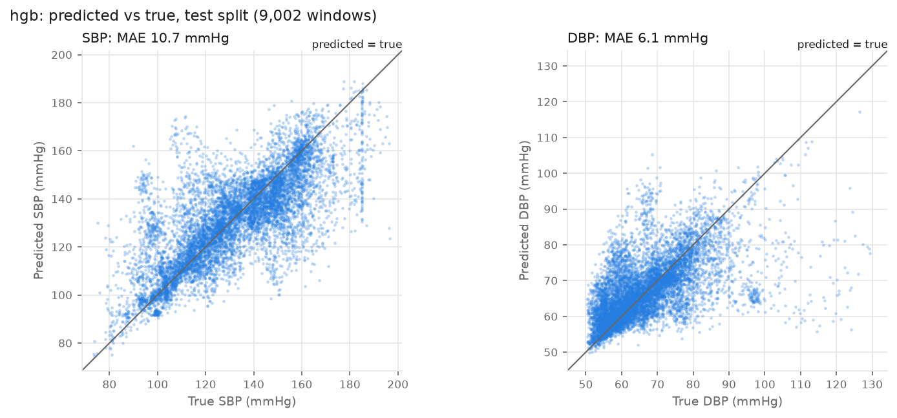
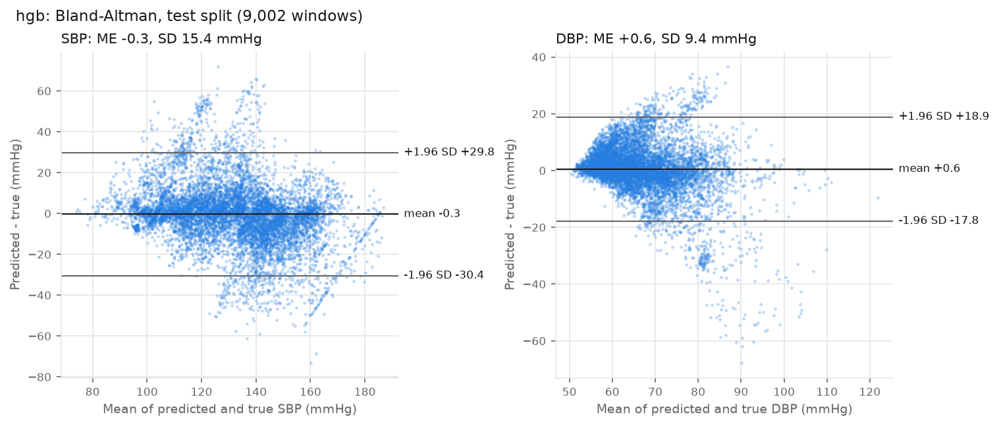
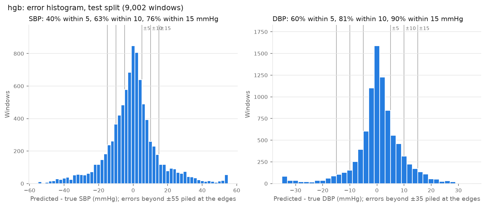

# Cuffless-BP

Estimates systolic (SBP) and diastolic (DBP) blood pressure from a fingertip pulse signal (PPG) and reports the error in mmHg against the AAMI and BHS standards that cuff monitors must meet.

> **Research demo, not a medical device.** Do not use these estimates to make health decisions.

**Status (Nov 26, 2026):** the held-out test split has been scored, once (Phase 4), and the
results below are from that run. `TODO` markers remain for the demo link, the team and the
fresh-environment reproduction check (Phase 5). Every number below comes from a file in `results/` or `splits/`.

## The problem and who has it

High blood pressure is a leading risk factor for stroke and heart disease, and it often
goes unnoticed because measuring it needs a cuff and a deliberate check. An optical pulse
sensor (PPG) is already in every pulse oximeter and most smartwatches. If blood pressure
could be estimated from that signal, people could be checked far more often. The open
question is how accurate such an estimate really is, measured in mmHg against the bar
that cuff monitors have to clear. This project answers that question honestly on a public
dataset, with a held-out test set and simple baselines to compare against.

Who it is for: researchers and students who want a transparent, reproducible cuffless BP
baseline, and, in the long run, people without easy access to a cuff.

## Install

Requires Python 3.11.

```bash
git clone https://github.com/tsengjohn44-lgtm/Cuffless-BP.git
cd Cuffless-BP
python3.11 -m venv .venv && source .venv/bin/activate
pip install -r requirements.txt     # versions are pinned
cp .env.example .env                # optional: change where the data is stored
```

## Run

| Command | What it does |
|---|---|
| `make all` | Downloads the data and rebuilds every validation result from scratch |
| `make demo` | Starts the Streamlit demo (no dataset or wifi needed) |
| `make test` | Runs the unit tests (pytest) |
| `make data` | Downloads `Part_1.mat` (about 0.8 GB) into `data/raw` |
| `make inspect` | Prints and explains the layout of one record |
| `make windows` | Cuts 10 s windows, labels SBP/DBP, applies quality filters, makes the split |
| `make features` | Computes PPG and ECG features per window |
| `make baselines` | Fits baseline 1 (and baseline 2) on the training split |
| `make train` | Tunes the main model on the validation split and saves the best setting |
| `make eval` | Scores every saved model on the **validation** split |
| `make final` | Scores every model on the **test** split. Run once, in Phase 4 only |

### Reproducing the evaluation

`make all` runs `data → windows → features → baselines → train → eval` and writes
`results/metrics.json`, `results/comparison_val.md`, `results/predictions_val.csv` and
the figures in `results/figures/val/`. The held-out test numbers come from a single
`make final` run, written to the same places with `test` in the name. `results/metrics.json`
holds whichever split ran last; the committed one is the test run, so to reproduce the
committed results run `make all` and then `make final`.

The split is committed in `splits/split.json`, and all random steps use fixed seeds, so the
same commit gives the same numbers on any machine with the pinned versions.

> TODO: confirm reproduction in a fresh environment (Phase 5) and note the run time.

## Data

[UCI "Cuff-Less Blood Pressure Estimation"](https://archive.ics.uci.edu/dataset/340/cuff+less+blood+pressure+estimation)
(dataset 340, CC BY 4.0), derived from ICU recordings in MIMIC-II. It holds 12,000 records
in four MATLAB v7.3 files (3.1 GB). Each record has three signals sampled at 125 Hz:

| Signal | Role |
|---|---|
| PPG, fingertip pulse wave | Model input |
| ABP, invasive arterial blood pressure (mmHg) | Ground truth labels |
| ECG lead II | Optional input, for pulse arrival time |

`make data` streams the UCI zip and unpacks `Part_1.mat` (3,000 records) on the fly, checking
its CRC32 checksum. The UCI server cuts downloads off at 1 GiB, and Parts 2 to 4 sit past that
point in the zip, so **all results here use Part_1 only**. With a full local copy of the zip,
`python -m bp.download --zip path/to.zip --parts 1 2 3 4` unpacks the rest.

Raw data is never committed (`data/` is in `.gitignore`).

## Method

**1. Windows and labels** (`src/bp/windows.py`). Each record is cut into back-to-back
10 s windows (1,250 samples). In each window we find the top and bottom of every heartbeat
in the arterial pressure. SBP is the median of the tops and DBP the median of the bottoms, so
one odd beat barely moves the label. Beats must be at least 0.33 s apart (a heart rate of
180 bpm) and stand out clearly, so the small dicrotic bump after each beat is not counted.

**2. Quality filters.** A window is dropped if its labels or its PPG look unreliable. Each
dropped window is counted under the first filter it fails (`results/window_filters.json`):

| Filter | Windows dropped (Part_1) |
|---|---|
| Missing samples (NaN) | 0 |
| Fewer than 5 beats | 48 |
| SBP outside 60–220 mmHg | 0 |
| DBP outside 30–130 mmHg | 33 |
| SBP ≤ DBP | 0 |
| Flat PPG | 0 |
| Clipped PPG (stuck at the sensor's floor or ceiling) | 698 |
| **Kept** | **64,093** of 64,872 |

Clipping is the main loss: every clipped window we plotted was a sensor dropout or a motion
artifact. 293 of the 3,000 records are shorter than 10 s and give no windows at all.

**3. Split by record, not by window** (`src/bp/split.py`). Windows from one record are near
copies of each other, so splitting by window would let the model see a test patient during
training. Each record goes to train, validation or test by a hash of the seed (42) and its
record id, aiming at 70/15/15. The result is 1,910 train, 390 validation and 403 test records
(`splits/split.json`). Only `evaluate.py --final` may read the test records.

**4. Features per window** (`src/bp/features.py`). The PPG is band-passed at 0.5–8 Hz, the
beats are found, and each feature is the median over the beats in the window:
heart rate and beat-to-beat variability; pulse amplitude; systolic upstroke time; pulse width
at 25, 50 and 75% of the beat's height; the area before vs. after the dicrotic notch; and the
second-derivative (APG) wave ratios b/a, c/a, d/a and e/a. Three signal-quality measures
(number of beats, how alike the beats are, PPG skewness) are kept for the model and for error
analysis. The arterial pressure is never read here, so the answer cannot leak into the inputs.

*Caveat on pulse arrival time (`pat_s`).* We measure it from the ECG R peak to the steepest
point of the next PPG upstroke. In this dataset the median is about 0.56 s, longer than the
0.2–0.4 s expected at the finger, which most likely means a recording delay between the ECG
and PPG channels that differs between records. We keep it as a feature, but it means "R peak
to PPG upstroke in this dataset", not a true physiological pulse arrival time.

**5. Models.** All are fit on the training split only and tuned on validation only.

| Model | What it is |
|---|---|
| Baseline 1 (`mean_baseline`) | Predicts the training mean SBP and DBP for every window. Anything worse than this has learned nothing |
| Baseline 2 (`pat_linear`) | Pulse arrival time + heart rate into one linear regression for SBP and DBP. A window with no PAT gets the training median |
| Main (`hgb`) | `HistGradientBoostingRegressor`, one for SBP and one for DBP, on all the features above. `make train` tries 16 settings (learning rate, number of trees, tree size, smallest leaf), keeps the one with the lowest validation MAE and prints the table |

## Evaluation

**What we measure.** For SBP and DBP separately, the error of every window (predicted minus
true, in mmHg) against the invasive arterial pressure:

- **Mean error (ME) ± standard deviation (SD).** The AAMI standard for cuff monitors requires
  |ME| ≤ 5 mmHg and SD ≤ 8 mmHg.
- **BHS grade.** The % of windows within 5, 10 and 15 mmHg. Grade A needs 60/85/95%,
  B 50/75/90%, C 40/65/85%, otherwise D.
- **Mean absolute error (MAE)**, the headline number, with a **95% confidence interval from
  1,000 bootstrap resamples of whole records**. Windows of one record are not independent,
  so resampling single windows would give an interval that is too narrow.

**What we compare against.** Every model is scored on the same windows as baseline 1 (the
training mean) and baseline 2 (pulse arrival time + heart rate). The main model is only
useful if it clearly beats both. `metrics.py` is unit-tested on hand-computed examples.

**How.** `make eval` scores validation; `make final` scores the held-out test split once,
after all tuning is done. Nobody looks at test numbers before that run, and nothing is
tuned after it.

### Results

Held-out **test** split: 9,002 windows from 403 records that played no part in training or
tuning, scored once by `make final`. From `results/metrics.json` (also
`results/comparison_test.md`). Errors in mmHg, predicted − true.

| Model | Target | ME ± SD (mmHg) | MAE (95% CI) | ≤5 / ≤10 / ≤15 mmHg | BHS | AAMI |
|---|---|---|---|---|---|---|
| Baseline 1 | SBP | +0.7 ± 22.7 | 19.1 (17.7–20.4) | 12 / 28 / 42% | D | fail |
| Baseline 1 | DBP | -0.5 ± 11.2 | 8.7 (7.8–9.5) | 32 / 66 / 90% | D | fail |
| Baseline 2 | SBP | +0.3 ± 20.8 | 17.1 (15.8–18.3) | 14 / 32 / 51% | D | fail |
| Baseline 2 | DBP | -0.3 ± 11.0 | 8.4 (7.6–9.3) | 35 / 67 / 90% | D | fail |
| Main (`hgb`) | SBP | -0.3 ± 15.4 | 10.7 (9.4–11.9) | 40 / 63 / 76% | D | fail |
| Main (`hgb`) | DBP | +0.6 ± 9.4 | 6.1 (5.3–7.0) | 60 / 81 / 90% | B | fail |





**What the numbers mean.** On recordings it had never seen, the main model's typical
error is 10.7 mmHg for SBP and 6.1 mmHg for DBP. That is roughly half the error of guessing
the average pressure every time (baseline 1: 19.1 and 8.7), and clearly better than the
classic pulse-arrival-time formula (baseline 2: 17.1 and 8.4); for both targets the main
model's 95% confidence interval does not overlap either baseline's. Its estimates are not
biased overall (mean error −0.3 and +0.6 mmHg), but they scatter too widely: the standard
deviation of the error is 15.4 mmHg for SBP and 9.4 for DBP, above AAMI's limit of 8, so it
**fails the AAMI criterion for both**, as cuffless methods usually do. By the BHS grades, DBP
reaches **B**, narrowly (90.3% of windows within 15 mmHg against a cut-off of 90%), and SBP is
D. The test results are slightly worse than validation (`results/comparison_val.md`), as
expected after choosing the model's settings on validation. In short: much better than the
baselines, but not accurate enough to replace a cuff.

### Where it works and where it fails

Measured on the **test** split (9,002 windows from 403 records), for the main model. `make
final` stores these numbers in the `error_analysis` section of `results/metrics.json` and
shows them as tables in `results/error_analysis_test.md`, including how much the model
relies on each feature. The same analysis on the validation split, written in Phase 3 before
the test run, is in `results/error_analysis_val.md`; the patterns below were already visible
there.

- **Extreme pressures, the biggest weakness.** The model pulls its estimates toward the
  middle of the range. When true SBP is below 100 mmHg it reads 15.4 mmHg too high on
  average (MAE 16.5); at 160 mmHg and above it reads 15.8 too low (MAE 17.4). Between 120
  and 140 mmHg the MAE is 7.9. DBP of 80 mmHg and above is read 12.9 too low (MAE 14.2).
  So the error is largest for low and high blood pressure, where a reading matters most.
- **Most of the error is a fixed offset per patient.** 74% of the SBP squared error (78% for
  DBP) is a constant offset per record: for a given record the model is consistently too
  high or too low, rather than noisy from one window to the next. The 10% of records with
  the largest offset hold 46% of the SBP squared error (61% for DBP). The pulse shape alone
  does not tell the model a patient's baseline pressure.
- **One calibration reading helps less than that suggests.** If each record's first window
  served as a cuff reading and its error were subtracted from the later windows, SBP MAE on
  those windows would drop from 10.6 to 8.6 mmHg and DBP from 6.1 to 4.5. One 10 s window is
  a noisy estimate of the offset, and pressure drifts within a record. This needs a
  reference reading for every patient, so it is a different use case, not our headline
  result.
- **Fast heart rate.** Error is lowest at 60–80 bpm (MAE: SBP 9.6, DBP 5.0) and higher at
  100–120 bpm (SBP 12.7, DBP 8.9). Above 120 bpm the SBP MAE is 15.3, but only 16 records
  reach that rate.
- **Noisy PPG, mainly for SBP.** By PPG skewness, a common signal-quality index, the
  noisiest windows (skewness below 0.45, about a third of them) have SBP MAE 11.4, against
  9.6 for the cleanest (0.8 and above). For DBP the effect is weak (6.0 against 5.4), and
  beat-shape consistency (`beat_corr`) shows no clear trend.
- **No ECG, no pulse arrival time.** In the 10% of windows where PAT cannot be measured, MAE
  rises from 10.5 to 11.6 mmHg for SBP and from 5.9 to 7.8 for DBP. PAT is the feature the
  model leans on most for SBP: shuffling it raises SBP MAE by 4.0 mmHg. As noted under
  Method, this PAT likely includes a recording delay that differs between records, so part
  of what the model learns from it may not carry over to other equipment.

Other limits, known before any numbers:

- **Outside ICU patients with arterial lines.** The model has only seen sedated, monitored
  ICU patients. It is untested on healthy people, on people moving, or on phone and watch
  sensors, whose PPG looks different from a clinical finger probe.
- **Extreme pressures.** Very high and very low BP are rare in the data, and tree models
  cannot predict outside the range they were trained on. The test numbers above confirm
  that the error is largest there.
- **Noisy or clipped PPG.** Windows with clipped PPG are dropped; on a real device they would
  need to be detected and rejected, not estimated.
- **A new patient.** There are no patient IDs, so the same person may appear in train and test.
  Scores may look better than they would on someone the model has never seen.
- **A passed AAMI check is not AAMI validation.** The real protocol needs at least 85 subjects
  measured with a reference cuff under a fixed protocol, which this dataset cannot provide.

## Demo

`make demo` starts a Streamlit app: pick a held-out window, see its PPG waveform, the model's
SBP/DBP next to the true arterial values, the model's typical error band, and its AAMI/BHS
result. It runs from `app/sample.npz` (a small sample of test windows written by `make final`)
with no download or wifi, and falls back to a validation preview (`app/sample_val.npz`) until
then. If anything fails to load, it shows a message instead of crashing.

> TODO: demo link, screenshot and video link.

## Who benefits, and who could be harmed

**Who benefits.** People without easy access to a cuff, who could one day get more frequent
checks from a sensor they already own; and researchers who want an honest, reproducible
baseline with errors stated in the clinical unit.

**Who could be harmed.**

- **False reassurance.** A reading that is too low could lead someone with high blood pressure
  to skip seeing a doctor. The demo shows the error band next to every number and says it is
  not a medical device.
- **People with darker skin.** Optical pulse sensors can read less accurately on darker skin.
  This dataset has no demographic data, so we cannot check whether our errors differ by skin
  tone, and we make no claim that they don't.
- **Over-trust in a number.** A single mmHg value looks precise. Without the error band, a
  user or clinician could treat it as a measurement rather than an estimate.

## Limitations

- **ICU patients with arterial lines** (MIMIC-II), not healthy people wearing a watch. Not
  tested on phone or watch sensors.
- **Possible patient leakage across records.** The dataset has no patient IDs, so splitting by
  record cannot rule out one person appearing in both train and test.
- **No demographic data**, so effects of skin tone, age or sex on PPG cannot be checked.
- **Part_1 only** (3,000 of 12,000 records), because the UCI server cuts downloads at 1 GiB.
- **Pulse arrival time includes a recording delay** in this dataset (see Method), so baseline 2
  is weaker than pulse arrival time on a properly synchronised device would be.
- **10 s windows, not readings.** Each window is scored as one estimate; a cuff reading
  protocol averages repeated measurements under rest conditions.

## What we would do with another month

- Train and test on all four parts (12,000 records) for more patients and a tighter interval.
- Try a small 1D CNN on the raw PPG and compare it with the feature model on the same split.
- Per-patient calibration (one cuff reading to set the offset), the way most cuffless devices
  work, and measure how much it helps.
- Test on PPG from a consumer wearable or a phone camera, with a cuff as reference, to see how
  much accuracy is lost outside the ICU.
- Validate on a dataset with demographics (for example later MIMIC versions or VitalDB) to check
  for differences by skin tone, age and sex.

## Team

> TODO: names and roles (lead + model, data + baselines, evaluation + write-up, demo + video).

## Credits

- **Dataset:** M. Kachuee, M. M. Kiani, H. Mohammadzade, M. Shabany, "Cuff-Less Blood Pressure
  Estimation", UCI Machine Learning Repository, dataset 340,
  https://archive.ics.uci.edu/dataset/340/cuff+less+blood+pressure+estimation, licensed CC BY 4.0.
  It is derived from the MIMIC-II waveform database (PhysioNet). The demo sample
  `app/sample.npz` contains a few hundred PPG windows from this dataset, shared under the same
  license with this credit.
- **Libraries:** numpy, scipy, h5py, pandas, scikit-learn, matplotlib, streamlit, pytest and
  ruff (versions in `requirements.txt`).
- **Methods from the literature:** the PPG skewness quality index follows Elgendi (2016);
  the AAMI and BHS criteria come from the published standards.
- No pretrained models or third-party code are included.
- **AI assistance:** Claude Code helped write the code and this README.
